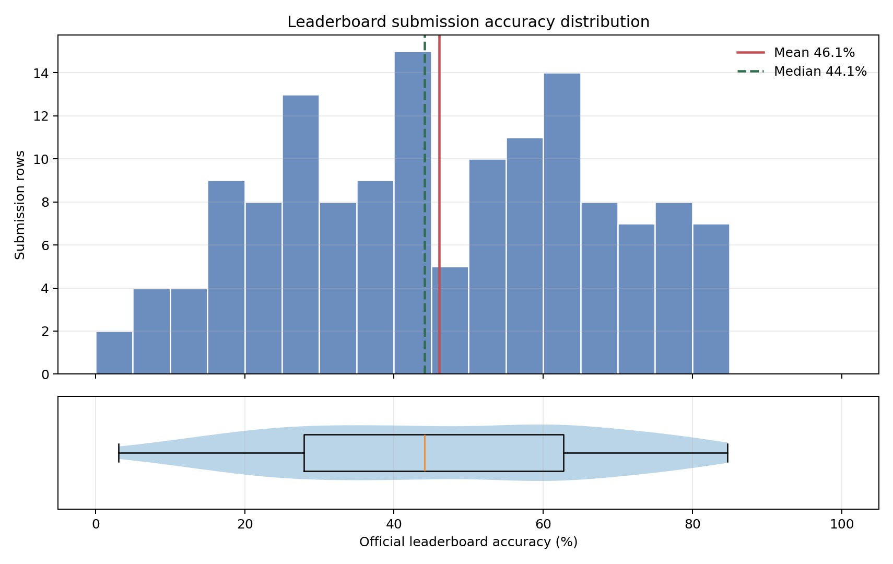
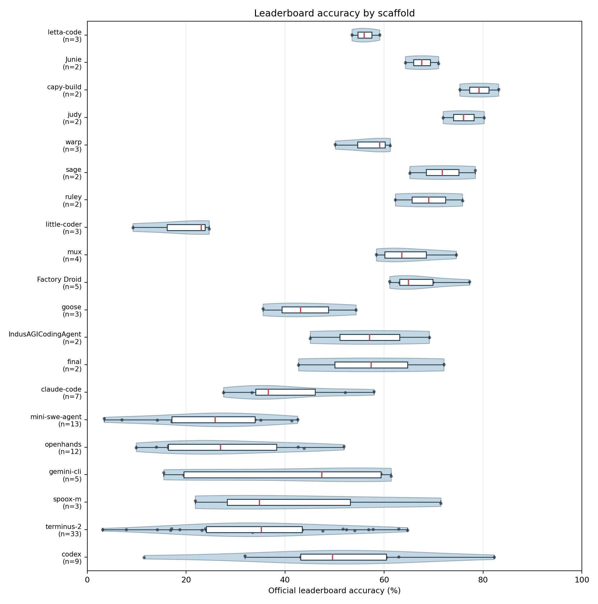
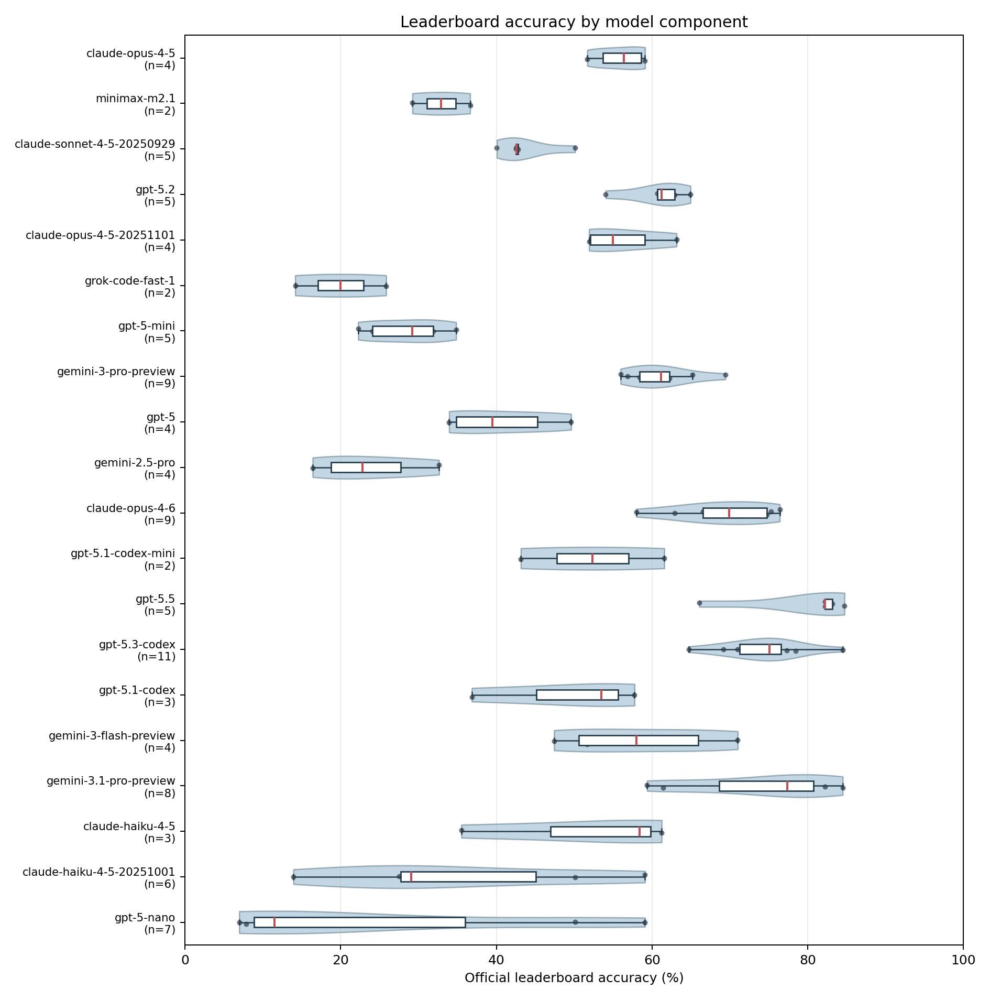
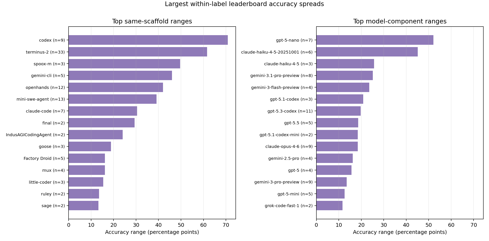

# Superficial Terminal-Bench Leaderboard Analysis

This report uses the current leaderboard snapshot and stays at submission-row level. Accuracy and +/- use scraped official leaderboard fields.

## Overall Submission-Level Picture

- Submission rows: 142.
- Rows with local trajectories: 74.
- Unique scaffolds: 43.
- Unique exact model labels: 61.
- Leaderboard accuracy: mean 46.1%, median 44.1%, range 3.1%-84.7%.
- Within-submission task-rate variance: mean 0.1427, median 0.1533.
- Leaderboard +/- estimate: mean 2.6%, median 2.7%.

## Preliminary Reading

- Same-scaffold comparisons are available for 22 scaffolds. The largest accuracy ranges are `codex` (70.8%), `terminus-2` (61.6%), and `spoox-m` (49.7%).
- Same-model comparisons are available for 29 exact model labels. The largest exact-model ranges are `gpt-5.1-codex` (20.9%), `gemini-3.1-pro-preview` (20.9%), and `gpt-5.5` (18.7%).
- After splitting comma-separated model labels, 31 model components appear with more than one scaffold. This view is useful for spotting mixed-model or ensemble rows that would otherwise hide under a combined label.
- The eta-squared values below are descriptive only. They are inflated when many groups have one or two rows, so they should guide where to inspect next rather than settle the scaffold-vs-model question.

## Visual Diagnostics

These figures are intended as a first-pass visualization of the leaderboard rows. Violin widths show the distribution shape, box plots show the median and interquartile range, and individual dots show the actual submission rows.

## Top Rows by Accuracy

| Rank | Scaffold | Model | Official accuracy | +/- | Has trajectories |
| --- | --- | --- | --- | --- | --- |
| 1 | nexau | gpt-5.5 | 84.7% | 2.1% | True |
| 2 | Lemoncode-agent | gemini-3.1-pro-preview,gpt-5.3-codex | 84.5% | 2.6% | False |
| 3 | capy-build | gpt-5.5 | 83.1% | 2.1% | False |
| 4 | codex | gpt-5.5 | 82.2% | 2.2% | False |
| 5 | polaris | claude-opus-4-7,gemini-3.1-pro-preview,gpt-5.5 | 82.2% | 2.8% | False |
| 6 | claude-wozcode-plugin | claude-opus-4-7 | 80.2% | 2.1% | False |
| 7 | judy | gemini-3.1-pro-preview | 80.2% | 2.6% | True |
| 8 | Lemoncode-agent | gemini-3.1-pro-preview,gpt-3.5-codex | 79.9% | 3.0% | False |
| 9 | sage | gpt-5.3-codex | 78.4% | 2.2% | False |
| 10 | Factory Droid | gpt-5.3-codex | 77.3% | 2.2% | False |
| 11 | terminus-kira-env-bootstrap | claude-opus-4-6 | 76.4% | 2.4% | True |
| 12 | ruley | gpt-5.3-codex | 75.8% | 2.0% | False |
| 13 | codelia | gpt-5.3-codex | 75.7% | 2.2% | False |
| 14 | capy-build | claude-opus-4-6 | 75.3% | 2.4% | False |
| 15 | simple_codex | gpt-5.3-codex | 75.1% | 2.4% | False |

## Same Scaffold, Different Models

These groups show how much leaderboard accuracy moves when the scaffold label is fixed and the model label changes. Large ranges suggest model choice matters within that scaffold, although scaffold versions are not collapsed here.

| Scaffold | Rows | Models | Mean acc. | Range | Std. | Best | Worst |
| --- | --- | --- | --- | --- | --- | --- | --- |
| codex | 9 | 9 | 49.3% | 70.8% | 20.2% | 82.2% | 11.5% |
| terminus-2 | 33 | 33 | 35.1% | 61.6% | 15.6% | 64.7% | 3.1% |
| spoox-m | 3 | 3 | 42.7% | 49.7% | 25.7% | 71.5% | 21.8% |
| gemini-cli | 5 | 4 | 40.6% | 46.0% | 21.8% | 61.4% | 15.4% |
| openhands | 12 | 12 | 28.4% | 42.0% | 13.2% | 51.9% | 9.9% |
| mini-swe-agent | 13 | 13 | 24.9% | 39.2% | 12.1% | 42.5% | 3.4% |
| claude-code | 7 | 7 | 40.3% | 30.4% | 10.9% | 58.0% | 27.5% |
| final | 2 | 2 | 57.4% | 29.4% | 20.8% | 72.1% | 42.7% |
| IndusAGICodingAgent | 2 | 2 | 57.1% | 24.1% | 17.0% | 69.1% | 45.1% |
| goose | 3 | 3 | 44.3% | 18.8% | 9.5% | 54.3% | 35.5% |
| Factory Droid | 5 | 5 | 67.3% | 16.2% | 6.5% | 77.3% | 61.1% |
| mux | 4 | 4 | 65.1% | 16.2% | 7.2% | 74.6% | 58.4% |
| little-coder | 3 | 2 | 19.0% | 15.4% | 8.5% | 24.6% | 9.2% |
| ruley | 2 | 2 | 69.0% | 13.6% | 9.6% | 75.8% | 62.2% |
| sage | 2 | 2 | 71.8% | 13.3% | 9.4% | 78.4% | 65.2% |
| warp | 3 | 3 | 56.8% | 11.1% | 5.9% | 61.2% | 50.1% |
| judy | 2 | 2 | 76.1% | 8.3% | 5.9% | 80.2% | 71.9% |
| capy-build | 2 | 2 | 79.2% | 7.9% | 5.6% | 83.1% | 75.3% |
| Junie | 2 | 2 | 67.6% | 6.7% | 4.8% | 71.0% | 64.3% |
| letta-code | 3 | 3 | 56.2% | 5.6% | 2.8% | 59.1% | 53.5% |

## Same Model, Different Scaffolds

These groups show how much leaderboard accuracy moves when the exact model label is fixed and the scaffold changes. Large ranges suggest scaffold choice matters for that model.

| Model | Rows | Scaffolds | Mean acc. | Range | Std. | Best | Worst |
| --- | --- | --- | --- | --- | --- | --- | --- |
| gpt-5.1-codex | 3 | 3 | 49.4% | 20.9% | 11.0% | 57.8% | 36.9% |
| gemini-3.1-pro-preview | 4 | 3 | 69.0% | 20.9% | 10.2% | 80.2% | 59.4% |
| gpt-5.5 | 4 | 4 | 79.0% | 18.7% | 8.7% | 84.7% | 66.1% |
| gpt-5.1-codex-mini | 2 | 2 | 52.4% | 18.4% | 13.0% | 61.6% | 43.1% |
| claude-opus-4-6 | 8 | 8 | 68.8% | 18.4% | 6.5% | 76.4% | 58.0% |
| gemini-3-flash-preview | 3 | 3 | 54.5% | 16.9% | 8.8% | 64.3% | 47.4% |
| gemini-2.5-pro | 4 | 4 | 23.7% | 16.2% | 7.2% | 32.6% | 16.4% |
| claude-haiku-4-5-20251001 | 4 | 4 | 24.9% | 15.9% | 7.4% | 29.8% | 13.9% |
| gpt-5 | 4 | 4 | 40.6% | 15.7% | 7.4% | 49.6% | 33.9% |
| gpt-5-nano | 5 | 5 | 11.6% | 14.8% | 6.0% | 21.8% | 7.0% |
| gpt-5.3-codex | 9 | 9 | 73.6% | 13.7% | 4.4% | 78.4% | 64.7% |
| gemini-3-pro-preview | 7 | 7 | 61.8% | 13.5% | 4.6% | 69.4% | 56.0% |
| gpt-5-mini | 5 | 5 | 28.4% | 12.6% | 5.3% | 34.8% | 22.2% |
| grok-code-fast-1 | 2 | 2 | 20.0% | 11.7% | 8.3% | 25.8% | 14.2% |
| claude-opus-4-5-20251101 | 4 | 4 | 56.2% | 11.2% | 5.3% | 63.1% | 51.9% |
| gpt-5.2 | 4 | 4 | 60.6% | 10.9% | 4.7% | 64.9% | 54.0% |
| minimax-m2.1 | 2 | 2 | 32.9% | 7.4% | 5.2% | 36.6% | 29.2% |
| claude-opus-4-5 | 4 | 4 | 55.9% | 7.4% | 3.5% | 59.1% | 51.7% |
| openai/gpt-oss-120b | 2 | 2 | 16.4% | 4.5% | 3.2% | 18.7% | 14.2% |
| grok-4-0709 | 3 | 3 | 25.2% | 4.0% | 2.0% | 27.2% | 23.1% |

## Same Model Component, Different Scaffolds

Some leaderboard rows list model ensembles or multiple model names. This exploded view splits comma-separated model labels before grouping, so mixed-model rows can still contribute to model-level pattern finding.

| Model component | Rows | Scaffolds | Mean acc. | Range | Std. | Best | Worst |
| --- | --- | --- | --- | --- | --- | --- | --- |
| gpt-5-nano | 7 | 6 | 23.9% | 52.1% | 21.7% | 59.1% | 7.0% |
| claude-haiku-4-5-20251001 | 6 | 5 | 34.8% | 45.2% | 16.6% | 59.1% | 13.9% |
| claude-haiku-4-5 | 3 | 3 | 51.7% | 25.7% | 14.1% | 61.2% | 35.5% |
| gemini-3.1-pro-preview | 8 | 6 | 74.2% | 25.1% | 9.5% | 84.5% | 59.4% |
| gemini-3-flash-preview | 4 | 3 | 58.6% | 23.6% | 10.9% | 71.0% | 47.4% |
| gpt-5.1-codex | 3 | 3 | 49.4% | 20.9% | 11.0% | 57.8% | 36.9% |
| gpt-5.3-codex | 11 | 11 | 74.3% | 19.8% | 5.2% | 84.5% | 64.7% |
| gpt-5.5 | 5 | 5 | 79.7% | 18.7% | 7.7% | 84.7% | 66.1% |
| gpt-5.1-codex-mini | 2 | 2 | 52.4% | 18.4% | 13.0% | 61.6% | 43.1% |
| claude-opus-4-6 | 9 | 9 | 69.1% | 18.4% | 6.1% | 76.4% | 58.0% |
| gemini-2.5-pro | 4 | 4 | 23.7% | 16.2% | 7.2% | 32.6% | 16.4% |
| gpt-5 | 4 | 4 | 40.6% | 15.7% | 7.4% | 49.6% | 33.9% |
| gemini-3-pro-preview | 9 | 9 | 61.1% | 13.5% | 4.2% | 69.4% | 56.0% |
| gpt-5-mini | 5 | 5 | 28.4% | 12.6% | 5.3% | 34.8% | 22.2% |
| grok-code-fast-1 | 2 | 2 | 20.0% | 11.7% | 8.3% | 25.8% | 14.2% |
| claude-opus-4-5-20251101 | 4 | 4 | 56.2% | 11.2% | 5.3% | 63.1% | 51.9% |
| gpt-5.2 | 5 | 5 | 60.8% | 10.9% | 4.1% | 64.9% | 54.0% |
| claude-sonnet-4-5-20250929 | 5 | 5 | 43.6% | 10.1% | 3.8% | 50.1% | 40.1% |
| minimax-m2.1 | 2 | 2 | 32.9% | 7.4% | 5.2% | 36.6% | 29.2% |
| claude-opus-4-5 | 4 | 4 | 55.9% | 7.4% | 3.5% | 59.1% | 51.7% |

## Coarse Variance Attribution

This is a one-way ANOVA-style eta-squared diagnostic on scraped official leaderboard accuracy, not a causal estimate and not a local reward-derived accuracy. It asks how much row-level official accuracy variance is associated with grouping by one label at a time.

- Scaffold label eta-squared: 0.678 across 43 scaffold groups.
- Exact model label eta-squared: 0.957 across 61 model groups.
- Exploded model component eta-squared: 0.890 across 54 model-component groups.

## Generated Artifacts

- `data/processed_live/leaderboard_scaffold_variance.csv`
- `data/processed_live/leaderboard_model_variance.csv`
- `data/processed_live/leaderboard_model_component_variance.csv`
- `reports/figures_live/leaderboard_accuracy_distribution.png`
- `reports/figures_live/leaderboard_accuracy_by_scaffold.png`
- `reports/figures_live/leaderboard_accuracy_by_model_component.png`
- `reports/figures_live/leaderboard_largest_accuracy_ranges.png`
